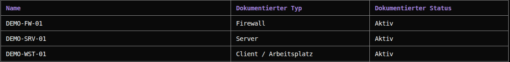
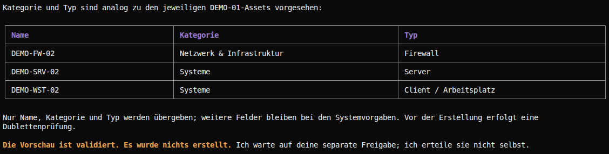
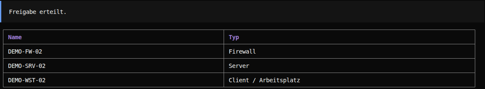
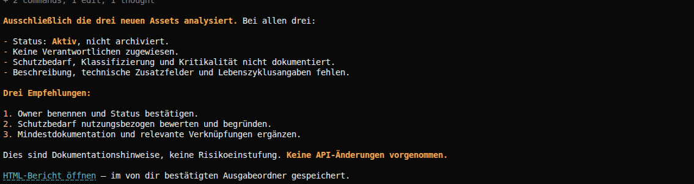

# audatisControl

**KI-gestützte Verwaltung und ISMS-Auswertung für audatis MANAGER – über das Model Context Protocol (MCP).**

`audatisControl` verbindet KI-Assistenten wie OpenCode oder VS Code mit unterstützten Funktionen der audatis MANAGER REST-API. Aktionen erfolgen über natürlichsprachliche Anweisungen; ein separater **ISMS Consulting Copilot** analysiert dokumentierte Zustände und erstellt kurze Maßnahmenberichte.

> **Unabhängiges Projekt.** Keine offizielle Erweiterung oder Kooperation mit audatis.

## Was ist möglich?

| Bereich | Funktionen |
| --- | --- |
| **Assets** | Auflisten, anlegen, aktualisieren, Verantwortlichkeiten und Schutzbedarf verwalten, Beziehungen prüfen |
| **Aufgaben** | Erstellen, bearbeiten, priorisieren und gesammelt verarbeiten |
| **Personal & Benutzer** | Mitarbeiterdatensätze anlegen und bearbeiten, Organisationen zuordnen; bestehende Systembenutzer lesen – **keine Benutzerkonto- oder Rollenerstellung** |
| **Risiken & Sicherheitsvorfälle** | Risiken lesen und analysieren; Vorfälle und unterstützte Verknüpfungen verwalten (abhängig von API und Berechtigung) |
| **ISMS-Daten** | Informationswerte, Geschäftsprozesse, Sicherheitsmaßnahmen und unterstützte Compliance-Einträge bearbeiten |
| **Analysen & Berichte** | Dokumentationslücken und Abhängigkeiten prüfen, Maßnahmen empfehlen, HTML-/Markdown-Kurzberichte erstellen |

**Verfügbare MCP-Werkzeuge:** 48 im Basismodus; bis zu 227 mit einer selbst autorisiert bereitgestellten API-Spezifikation 1.3.1. Dazu kommen **7 Tools** im eigenständigen ISMS Consulting Copilot. Der Umfang hängt von Modulprofil, API und Berechtigungen ab.

## Live-Demo mit OpenCode

Die folgenden Screenshots zeigen einen **echten Durchlauf in einem Testmandanten**. Mandantenangaben sind aus den Bildausschnitten entfernt.

**1. Assets abrufen**

> Liste alle vorhandenen Assets vollständig auf und zeige Name, Typ und dokumentierten Status. Keine Änderungen.



**2. Drei Assets vorbereiten und nach Freigabe anlegen**

> Bereite DEMO-FW-02, DEMO-SRV-02 und DEMO-WST-02 vor. Zeige den Erstellungsplan und warte auf meine Freigabe.



Nach separater Freigabe wurden die drei Test-Assets über die API erstellt:



**3. Dokumentation prüfen und Kurzbericht erstellen**

> Analysiere ausschließlich die drei neu erstellten Assets. Prüfe Verantwortliche, Status und Schutzbedarf. Gib maximal drei Empfehlungen und erstelle einen kurzen HTML-Bericht. Keine API-Änderungen.



Der Asset-Kurzbericht des ISMS Consulting Copilot enthält eine Assetübersicht, bis zu drei Befundgruppen und Handlungsempfehlungen. Beim lokalen CLI-Export bleiben vollständige Nachweise separat in `details.json`. **Eine Dokumentationslücke ist kein Nachweis einer technischen Schwachstelle.**

## Schnellstart

Voraussetzungen: Python **3.11+**, ein autorisierter audatis MANAGER API-Zugang und ein MCP-fähiger Client.

```bash
git clone https://github.com/Truecrypt313/audatis-control-mcp.git
cd audatis-control-mcp
python3 -m venv .venv
.venv/bin/python -m pip install -r requirements.txt -r requirements-v2.txt
cp .env.example .env
```

`.env` lokal konfigurieren und die [MCP-Beispielkonfiguration](.vscode/mcp.example.json) für `server.py` sowie `copilot_server.py` verwenden. Eine Herstellerspezifikation ist **nicht** im Repository enthalten und für die gezeigte Asset-Demo nicht nötig.

**Weiterlesen:** [Einrichtung](docs/PUBLIC_SETUP.md) · [Live-Demo](docs/ASSET_DEMO.md) · [ISMS Copilot](docs/PUBLIC_COPILOT.md) · [Sicherheit](docs/PUBLICATION_SECURITY.md)

## Sicherheit & Lizenz

Schreibzugriffe verändern reale Datensätze. Ausschließlich autorisierte Testmandanten und minimale Berechtigungen verwenden; die Demo sieht eine separate Freigabe vor. **Einige bestehende Werkzeuge schreiben sofort; eine separate Freigabe ist nicht für alle Werkzeuge technisch erzwungen.** Modulprofile ersetzen keine API-Berechtigungen. Kein automatischer ISO-27001-/NIS-2-Konformitätsnachweis.

**Lizenz:** [PolyForm Noncommercial 1.0.0](LICENSE.md) · [Kommerzielle Lizenzierung](COMMERCIAL-LICENSING.md) · [Copyright-Hinweise](NOTICE)
